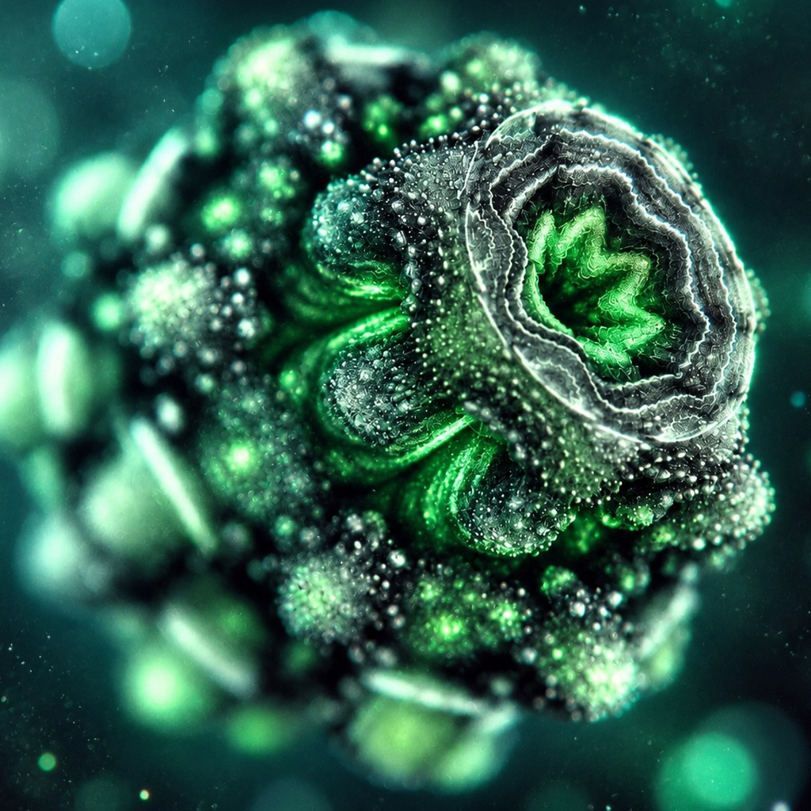

<p align="center">
  
</p>

# BorgVR

BorgVR is a bricked, out-of-core, ray-guided volume rendering system developed by the
[Computer Graphics and Visualization Group](https://www.cgvis.de/) at the University of
Duisburg-Essen. It started as a native Apple Vision Pro renderer and has since grown into
a family of native applications for **visionOS**, **iOS/iPadOS**, and **macOS**, accompanied
by Swift and C++ dataset servers and a WebGPU browser renderer.

The project is intended for interactive exploration of large volumetric datasets. It combines
native Metal renderers, dataset conversion tools, local and remote dataset servers, SharePlay
collaboration, and a WebGPU browser frontend served directly by the dataset server.

The current development version is **3.7**. The SharePlay wire protocol is version **3.3**.

## What Is Included

- **VisionApp**: native visionOS volume renderer with spatial interaction, SharePlay, annotations,
  measurements, Logitech Muse, and PlayStation VR2 Sense controller support.
- **iOSApp**: adaptive native iPhone and iPad volume renderer with local and remote datasets,
  SharePlay, annotations, and measurements.
- **macOSApp**: native Mac renderer with import/export tools, scripting, dockable editors,
  annotations, measurements, and an optional background server.
- **macOSServer**: Mac GUI for dataset conversion, serving, and server-to-server synchronization.
- **TerminalServerApp**: command-line dataset server.
- **TerminalConverterApp**: command-line dataset conversion tool.
- **BORGVRServerCPP**: cross-platform C++17 implementation of the dataset server protocol,
  including synchronization and the embedded WebGPU frontend.
- **web**: responsive WebGPU renderer served directly by a BorgVR server.
- **html**: bilingual user guide, embedded macOS Help, support, and privacy pages.
  Start with the [manual](html/index.html) or the guide to
  [datasets, edit states, and SharePlay](html/datasets.html).

## Features

### Rendering

- Bricked out-of-core rendering of volumes larger than GPU memory.
- Native Metal raycasters on visionOS, iOS/iPadOS, and macOS, plus a WebGPU browser renderer.
- Transfer-function, illuminated transfer-function, isosurface, clipping, LOD, and adaptive
  sampling controls.
- visionOS offers a local foveation sampling-strength slider (0...4, default 1): disable
  rate-map-based sample reduction or amplify it for a performance/quality trade-off without
  changing sampling in the full-rate center. The setting is included in settings backups.
- Configurable ambient, diffuse, and specular lighting with an interactive light-direction
  arcball, shared across native clients and WebGPU.
- GPU-guided brick requests with progressive paging into a brick atlas.
- Interactive transfer-function editors and persistent transfer-function catalogs.
- Up to four data channels with 8 or 16 bits per channel, plus scalar 32-bit integer volumes.
  Each channel has its own value range and transfer function; brick visibility accounts for
  every channel rather than relying on a single combined range.
- Physical voxel spacing is preserved through import and LoD generation. Dataset information
  reports real-world extents using suitable metric units while rendering remains normalized.
- Native object and measurement tools can project onto the volume surface. On visionOS,
  optional snapping follows the eye-to-tool ray; projected strokes use depth smoothing.
- macOS menus expose visualization commands and shortcuts, including arrow-key volume
  translation, with the bilingual HTML manual available as built-in Help.
- A local **User Interface** settings category on all native platforms can hide individual
  rendering/interaction modes, the reset row, and individual or all panel buttons. At least
  one rendering and interaction mode remains available; single-mode selectors disappear.
  RGB/RGBA rendering is unaffected. Diagnostics visibility is configured in the same category,
  and all preferences are included in settings import/export.
  A locally hidden mode activated through SharePlay temporarily appears as a disabled selected
  option, even in a normally single-mode selector, without changing local preferences. Screen
  panel buttons also follow their associated interaction modes; visionOS keeps them independent
  so Muse and PSVR tools retain access to their panels.

### Dataset File Format

The `.data` format uses metadata version **5**. A one-byte component-type tag distinguishes
unsigned integers, signed integers (8/16/32 bits), and IEEE-754 Float32/Float64. All channels
share one type. Dataset, channel, and brick bounds use the same type and byte width as the
voxel components, in little-endian order. NaN propagates to both bounds of the affected range;
infinities remain valid bounds. Rendering and processing currently still require unsigned data.

The v5 header also contains a one-byte `channelInterpretation` after the component-type tag:
`0` means independent scalar channels, `1` means RGB, and `2` means RGBA. Stored ASTC LDR
bricks use `3` = RGB ASTC 4x4, `4` = RGBA ASTC 4x4,
`5` = RGB ASTC 8x8, and `6` = RGBA ASTC 8x8. The logical component count stays three/four;
ASTC RGB has opaque alpha. Each Z slice is tiled in row-major 16-byte ASTC blocks, with no
ASTC file header. Brick dimensions must be multiples of the selected footprint. Optional
LZ4 wraps this payload independently; the full brick byte count is the ASTC byte count,
not the decoded voxel count. The numeric file-format version remains 5.
RGB/RGBA datasets require exactly three/four unsigned 8-bit channels and store colors without alpha
premultiplication. Three/four components alone never imply color. NRRD `RGB-color` and
`RGBA-color` kinds preserve this distinction on import/export. QVIS also accepts `UCHAR3` and
`UCHAR4`. Only `UCHAR4` together with `ObjectModel: RGBA` selects color; `ObjectModel` is otherwise
ignored and components remain independent scalars. An explicit `Components` count must agree with
the format. RGB omits dataset and brick
value ranges entirely; RGBA stores only the alpha range, not RGB bounds. Native and WebGPU renderers
use a direct-color raycaster without a transfer function or lighting for these volumes.
RGB/RGBA volumes can optionally use a lossy ASTC atlas on Apple GPUs. The **JIT atlas compression**
option in Rendering settings offers
no compression, ASTC 4x4, or ASTC 8x8, taking effect when opening a dataset. iOS defaults to
ASTC 8x8 with a 1024 MB atlas; visionOS defaults to ASTC 4x4 and macOS to no compression. The compressed
atlases use one byte or one quarter byte per voxel instead of four in GPU memory;
files and source voxels remain unchanged. Direct GPU Erase/Restore
is disabled for compressed atlases; CPU-edited bricks are re-encoded and uploaded instead. RGB bricks
are always nonempty; RGBA brick/subblock skipping uses only maximum alpha and the alpha-epsilon
threshold. Epsilon never changes the color/alpha samples used for rendering.
Import settings independently select **Color compression on import (RGB/RGBA)**
(none/ASTC 4x4/ASTC 8x8, default none) and LZ4. Scalar imports ignore color compression.
Unlike runtime-only atlas compression, import-time ASTC permanently reduces the stored precision.
Stored ASTC selects its own atlas format regardless of the runtime preference; unchanged bricks
upload directly without recompression. Editing and flat-volume export decode voxel data, while
edited `.data` exports retain ASTC and optional LZ4. WebGPU decodes before uploading ordinary 3D
textures, including its worker and cache recovery paths. The bounded software decoder supports
the constant and one-partition LDR block modes emitted by BorgVR; other encodings report an error.
Scalar TF and ISO modes remain separate. Older v5 headers without this byte must be
updated with the external `BorgVR-v4-to-v5/borgvr_v5_upgrade` tool; the numeric format version
remains 5. The v4 converter now writes the extended v5 layout directly.

An ordered provenance history stores UTC timestamps (Unix milliseconds) and text for sources,
imports, fusion, completed remote downloads, and materialized edits. A separate free-form
UTF-8 `meta` field can hold additional metadata. Provenance and `meta` each support optional
raw LZ4 block compression, independently of brick compression; readers limit each decoded
text block to 64 MiB. The existing short and long dataset descriptions remain separate.

Older `.data` versions must be converted externally; native clients and servers read version 5
only. UUIDs and brick payload bytes can be retained when upgrading version 4 files.
Import dialogs include an optional source note and acquisition date/time. Conversion adds a
current, non-localized `converted by TOOL VERSION` provenance entry automatically.

### Collaboration

- SharePlay collaboration with synchronized datasets, transforms, rendering parameters,
  transfer functions, lighting, markers, and measurements.
- Protocol-version negotiation rejects incompatible clients with an actionable minimum-version
  message before rendering state is exchanged.
- Named and color-coded participants, shared or private screen views for iOS and macOS clients,
  and spatial screen-view visualization and manipulation on Apple Vision Pro.
- Host handover, explicit leave/waiting states, and synchronized initial state for participants
  joining an active session.
- Optional ad-hoc dataset servers limited to the session's active dataset, and a persistent
  origin catalog. Participants exchange shareable sources, retry unavailable endpoints, and can
  recover an active remote renderer through another server that provides the same dataset.
  A participant can become an additional source when its local download completes.
- Password-protected sources have an explicit sharing permission. Sources not allowed to be
  shared remain private; dataset payloads are fetched from servers, not tunneled through SharePlay.

### Objects And Spatial Input

- Named and colored spheres, optional direction rays, freehand strokes, and instanced opaque
  meshes on all native clients and in WebGPU.
- OBJ and STL import into BorgVR's self-contained `.mesh` format, with descriptions, positions,
  normals, vertex colors, texture coordinates, and embedded texture support. Mesh export to OBJ
  is available through the macOS import/export tools.
- Mesh coordinates are in meters. Native placement warns about objects whose size differs
  substantially from the dataset, and each instance has its own transform.
- Separate drawing and placement modes, multi-selection, server object catalogs, and binary
  `.marker` files that store spheres, strokes, and mesh instances with dataset identity checks.
  SharePlay synchronizes placements and resolves missing mesh assets through available sources.
- Hand-based drawing, object placement, and picking on Apple Vision Pro.
- Logitech Muse spatial-stylus drawing on visionOS 26 or newer, with live stroke radius and
  color controls, pressure-sensitive drawing, and configurable tools when opening a dataset.
- Independent left- and right-hand PlayStation VR2 Sense controller tools with configurable
  button and thumbstick-axis actions, volume manipulation, drawing, placement, measurement,
  and shared tip previews. Controller and Muse tool modes are independent of the hand mode.

### Measurements

- Interactive polyline length, planar convex-area, and convex-volume measurements on visionOS,
  iOS/iPadOS, and macOS using physical dataset dimensions.
- Editable control points, real-time values with automatically selected metric units, and
  rendering integrated with the volume depth/compositing pipeline.
- Measurement synchronization through SharePlay and a dataset-aware binary `.measurement`
  format for local save/load workflows, including server catalogs in WebGPU.
- Direct hand, Logitech Muse, and PlayStation VR2 Sense controller measurement interaction on
  Apple Vision Pro.

### Volume Editing And Saved State

- Non-destructive spherical erase and restore brushes on all three native rendering platforms,
  with per-channel selection for multi-channel volumes. Restoring recovers original voxel values,
  including where erase strokes overlap.
- Original data remains unchanged. Named edit variants are stored in a `.data.edits` companion
  directory, can be reopened or managed separately, and can be exported as a new `.data` dataset.
  SharePlay maintains a shared edit state and synchronizes brush operations and cursors.
- Background brick updates and LoD rebuilding keep edits consistent across resolution levels.
  Incompatible edit states are rejected rather than silently applied to a different source volume.
- One-click dataset-state save/restore combines visualization settings, all channel transfer
  functions outside Iso mode, objects, and measurements when present, with overwrite confirmation.
- Separate automatic load/save settings for transfer functions, objects, measurements, and
  visualization state. Saved visualization state includes render mode, isovalue, clipping,
  lighting, and transforms; visionOS stores its spatial transform relative to the viewer's head.

### Volume Registration, Fusion And Conversion

- DICOM directory selection on macOS, iOS/iPadOS, and visionOS, including sandbox-safe folder
  access without selecting every slice individually.
- Format-independent fusion into a two-channel volume on all three native platforms. Each
  input can independently be a DICOM series, a native BorgVR `.data` volume, or another
  supported volume file such as NRRD/NHDR. Mixed-format pairs are supported. Both inputs are
  decoded to temporary RAW volumes before the shared coarse-to-fine NMI rigid registration.
  Registration uses physical voxel spacing and available orientation information; DICOM
  frame-of-reference information supplies the initial pose when the frames match. Otherwise,
  the physical centers are aligned before optimization. Different grid sizes and crops are allowed.
  Inputs must currently be single-channel integer volumes with matching 8-, 16-, or 32-bit precision.
  NRRD direction vectors and declared metric units are interpreted according to the
  [NRRD specification](https://teem.sourceforge.net/nrrd/format.html).
- The reference channel is retained; the registered channel is resampled using configurable
  trilinear or nearest-neighbor interpolation, with zero outside its bounds. DICOM pixel padding
  is excluded from registration sampling.
- Optional per-channel 8-bit import quantization maps each nonconstant channel's observed range
  to 0...255 before bricking and LoD generation. The original ranges are written to the log.
  This is lossy and trades intensity precision for smaller storage and texture payloads.

### Isosurface Export

- Full-resolution OBJ isosurface extraction in the macOS renderer using Marching Cubes 33,
  with Metal-accelerated classification when available and a CPU fallback.
- Extraction uses the normal brick-access interface for local and remote datasets, handles
  brick overlaps without duplicate cells, skips non-intersecting bricks, and reports progress
  with cancellation. Vertex normals interpolate central-difference sample gradients.
- Coordinates are exported in meters by default. An optional setting normalizes the longest
  dataset axis to `[-1, 1]` instead.
- Available from the macOS UI and menu, the `X` shortcut in Iso mode, `.gsc` commands, and MCP.

### Portable Settings

- Export and import application settings as registered JSON-based `.borgvrsettings` files.
  Open a settings file on another native app to apply the supported entries after confirmation.
- Imports leave absent settings unchanged and ignore unknown or unsupported entries, allowing
  files to be shared between platforms and application versions.
- Export asks whether to include passwords, access tokens, and certificates. Files containing
  credentials are sensitive, unencrypted JSON and should only be shared through trusted channels.

### Data And Servers

- Dataset import and conversion from BorgVR, QVIS, NRRD/NHDR, PVM/PVM2/PVM3, IV3Dm, UVF, VFF, and DICOM workflows,
  including physical DICOM spacing.
- BorgVR datasets can be exported at any stored LoD as a flat, uncompressed NRRD volume while
  retaining the corresponding voxel spacing.
- Password-protected Swift and C++ dataset servers serving datasets, transfer functions,
  object placements, meshes, and measurement files.
- Periodic server-to-server synchronization in the macOS server and C++ server, including
  resumable downloads of incomplete datasets.
- Optional HTTPS WebGPU hosting from the Swift server with generated self-signed certificates
  or imported PKCS#12 identities.
- Resilient remote paging reconnects interrupted streams, repeats complete brick transactions,
  validates replacement-source metadata, and resumes incomplete local caches.

### macOS Automation

- Drag-and-drop `.gsc` scripts with a live execution log and repeatable interaction, rendering,
  and screenshot commands.
- The companion [Graphics Script Editor](https://github.com/JensDerKrueger/GraphicsScriptEditor)
  provides a graphical environment for conveniently creating and editing `.gsc` scripts for the
  macOS renderer.
- Synchronous text, file, and directory input functions for interactive scripts.
- Scriptable QVIS, NRRD, PVM, IV3Dm, UVF, VFF, and DICOM import, BorgVR LoD export, and configurable import
  brick size, overlap, and border handling.
- Local erase/restore brushes, sample batches in physical meters, background-job status and
  waiting, discarding edits, and cancellable edited-dataset export with progress.

### MCP Automation

- The visionOS, iOS/iPadOS, and macOS renderers contain an optional Model Context Protocol
  server at `/mcp`, independent of the dataset and WebGPU servers.
- HTTP requests are limited to 4 MiB including at most 16 KiB of headers. Headers must arrive
  within 10 seconds, the full request within 60 seconds, with no receive pause longer than
  10 seconds. Response transmission has a separate 30-second limit; command execution is not
  counted as receive time. Remote authentication is checked as soon as the headers arrive.
- Dataset-server text replies are bounded to 4 MiB and catalog lists to 10000 entries
  (handshake/info replies: 16 KiB). A complete MCP catalog query has a 60-second deadline,
  a 2000-dataset limit and a 16 MiB serialized catalog-data budget. Metadata-only queries
  accept up to 32 MiB per remote dataset and do not allocate brick buffers. Task cancellation
  and deadline expiry close active catalog connections; budget violations report explicit errors.
- MCP clients can inspect the active dataset and visualization state, change the render mode,
  model/view transform, isovalue, clipping, and lighting, wait for completed render frames, and
  retrieve the current rendered view as a PNG image.
- The MCP adapter and the macOS `.gsc` interpreter use the same application command layer for
  shared visualization operations.
- On macOS, `get_window_state`, `resize_window`, and `set_fullscreen` control the main window,
  not detached panels. Resize supports logical points or backing pixels and content or full-frame
  dimensions (including decoration). GSC provides `getwindowstate`, `resize width height`
  (points/content), `resize width height pixels frame`, and `fullscreen true|false`.
  Fullscreen transitions finish before the next command continues.
- `get_transfer_function` / `set_transfer_function` expose each zero-based channel as straight
  RGBA bytes (0...255). Compact ramps are linearly resampled to the current table size.
  `load_transfer_function` / `save_transfer_function` use native `.tf1d` files.
- `get_background` / `set_background` expose system, solid, and vertical-gradient screen
  backgrounds with primary/secondary RGBA colors (0...1). visionOS retains passthrough.
  `capture_screenshot` supports `include_alpha` (default true) and an optional `output_path`.
  Without alpha, the configured screen background is composited into the PNG; on visionOS
  passthrough is replaced by black. With alpha, only the transparent render image is captured.
- `save_visualization_state` / `load_visualization_state` save and restore a named JSON picture
  configuration: all channel TFs, transform, render mode/isovalue, clipping, lighting, background,
  and screen projection. The same dataset must be open; visionOS uses the UI's head-relative pose.
  GSC equivalents are `savestate` / `loadstate`; `gettransferfunction`, `settransferfunctionjson`,
  channel-aware `loadtf` / `savetf`, `getbackground`, and `screenshot filename false` are also available.
- `save_settings`, `reset_settings` (requires `confirm: true`), and `load_settings` provide a
  backup/reset/restore workflow using UI-compatible `.borgvrsettings` files. Credentials are
  exported only with `include_credentials: true`. Load/reset preserve the running MCP connection's
  enable, port, authentication and TLS settings. GSC exposes `savesettings filename includeCredentials`,
  `resetsettings`, and `loadsettings`. MCP save tools refuse existing files unless `overwrite: true`;
  paths refer to the app device and must be sandbox-accessible.
- Opening a dataset through MCP or GSC bypasses automatic loading of transfer functions, view/panel
  state, objects, measurements and the last selected edit state. Automation starts from the original
  volume and default visualization parameters; explicit load commands remain available. Interactive
  opening continues to follow the user's auto-load settings, without changing those preferences.
- Both also use one local volume-editing implementation for erase/restore, brush configuration,
  edit status, discarding edits, and edited-dataset export. MCP export jobs expose progress and
  cancellation; GSC waits for completion. SharePlay uses a separate shared edit state and synchronizes erase/restore cursors.
- Pending edit bricks finish automatically before opening, without an additional prompt. Opening and export
  share an exact bottom-up CPU/Metal builder with bounded caches and child-brick reuse, independent
  of the renderer's GPU preview. GSC `preparevolumeedits` and MCP `prepare_volume_edits` expose
  foreground preparation without discarding recorded edits on cancellation.
- Edit caches keep raw/LZ4 brick payloads and a persisted table of contents. Normal reopening
  reads only that table; recovery scans are reserved for missing or damaged tables. Unchanged
  mask checkpoints are not rewritten when switching states. Masks use compact binary tree tags
  for checkpoint storage and SharePlay snapshots rather than per-node property-list objects.
- MCP is disabled by default and listens on `localhost` unless network access is enabled. In that
  mode it listens on all network interfaces over HTTPS and may be internet-reachable,
  depending on the surrounding network configuration. Connections require a generated bearer token.

### WebGPU

- Responsive desktop and mobile UI with touch interaction and shareable renderer URLs.
- Optional persistent brick cache backed by IndexedDB, including cache statistics and clearing.
- Per-channel transfer-function editing, lighting, and physical dataset dimensions.
- Dataset provenance with timestamps is available in the dataset information panel.
- GPU-generated subbrick skipping and opacity-adaptive sampling are enabled by default.
  Both can be toggled in the Rendering panel; adaptive sampling applies to TF modes only.
- Server-provided transfer-function, object, mesh, and measurement catalogs, plus local
  annotation-file loading.
- Spheres, strokes, textured mesh instances, and length/area/volume measurement visualization
  with value labels. Opaque objects are rendered separately and composited with the volume.
- The displayed application version is supplied by the serving BorgVR server.

## Repository Layout

```text
AppSupport/             Shared Swift UI, renderer support, shaders, settings, and WebGPU assets
BORGVR-IO/              Dataset readers, metadata, raw access, and conversion helpers
BORGVR-Render/          Metal rendering infrastructure
BORGVR-Services/        Swift TCP dataset server and HTTP/WebGPU server
BORGVRServerCPP/        C++ dataset server implementation
VisionApp/              visionOS app target
iOSApp/                 iPhone and iPad app target
macOSApp/               macOS renderer app target
macOSServer/            macOS server/converter app target
TerminalServerApp/      Swift command-line dataset server
TerminalConverterApp/   Swift command-line converter
web/                    WebGPU browser frontend
html/                   User guide, macOS Help, support and privacy pages
Scripts/                Example macOS scripting files and command definitions
TransferFunctions/      Bundled transfer-function presets
```

## Building

### Requirements

- Xcode with the SDK required by the selected target. The current project targets iOS/iPadOS
  17.0 or newer, macOS 15.2 or newer, and visionOS 26.0 or newer.
- Apple development signing for device and App Store builds.
- A C++17 compiler and `make` for the standalone C++ server on macOS or Linux. A Visual Studio
  solution is also included for Windows.
- A browser with WebGPU support for the browser renderer. WebGPU on iPhone and iPad requires
  iOS/iPadOS 26 or newer.

### Apple Applications

Open `BorgVR.xcodeproj` in Xcode and select the scheme for the platform you want to build.

Common schemes:

- `VisionApp`
- `VisionApp Release`
- `iOSApp`
- `iOSApp Release`
- `macOSApp`
- `macOSApp Release`
- `macOSServer`
- `macOSServer Release`
- `TerminalServerApp`
- `TerminalConverterApp`

For App Store or device builds, configure your Apple development team and signing settings in Xcode.
The project uses the shared bundle identifier configured in the Xcode project.

### Tests

Run the fast unit, parser, conversion, protocol, and structure test suite with:

```sh
Scripts/run-test-suite.sh
```

Use the full mode to additionally compile all six Apple application targets:

```sh
Scripts/run-test-suite.sh --full
```

Set `VERBOSE=1` to include the successful test logs in the report. Failed test logs are always
shown, and the suite exits with a nonzero status if any test or build fails.

### Command-Line Volume Generator

The `TerminalConverterApp` scheme converts DICOM, image sequences, QVIS, NRRD, PVM, IV3Dm, UVF, VFF, and Zarr input, exports any LoD of a
BorgVR dataset as a flat volume, repacks existing `.data` files, and can create reproducible synthetic volumes. Export uses one
deliberately simple interchange representation: an uncompressed inline NRRD file.

```sh
TerminalConverterApp E <input.data> <output.nrrd> <lod>
```

LoD `0` reconstructs the full-resolution source volume. Higher LoDs export the stored downsampled
levels while preserving their corresponding physical voxel spacing. Importing and exporting works
for one- and multi-component data with 1-, 2-, or 4-byte components.

Mode `R` rebuilds an existing BorgVR file with a different brick size, overlap, quantization,
or compression:

```sh
TerminalConverterApp R input.data repacked.data 32 2
TerminalConverterApp R input.data small.data 32 2 --quantize-8bit
TerminalConverterApp R color.data color-astc.data 64 2 --color-compression astc8x8 --no-lz4
```

Repacking reconstructs LoD `0` into a temporary RAW file and uses the existing conversion pipeline
to rebuild all LoDs. Allow temporary disk space for the complete decoded volume and, when
quantizing, its 8-bit intermediate. Descriptions, physical voxel spacing, channel semantics, meta
text and existing provenance are retained. The result gets a new UUID and additional repacking
and conversion history; derived brick ranges are recalculated. The source file is never replaced.
Without options, sample precision is retained, LZ4 is enabled and ASTC is disabled. ASTC input is
decoded first; encoding ASTC again is lossy. Overlap `0` is allowed in this mode.
`--quantize-8bit` is also available for the other import/generation modes and uses each channel's
observed range independently.

Image sequence import selects a directory and interprets its images as Z slices in lexicographic
filename order (use zero-padded numbers, e.g. `001.png`, `002.png`). PNG, JPEG, TIFF and other
ImageIO-supported raster images are decoded to 8-bit sRGB. All slices must have identical
dimensions after image orientation is applied; multi-frame files and unreadable images are
rejected. Hidden files, non-image sidecars, symlinks and subdirectories are ignored. If any
slice has alpha, the entire volume is RGBA; otherwise it is RGB. The import dialogs on macOS,
iOS and visionOS ask for the **whole volume's X/Y/Z dimensions in meters**. The CLI equivalent is:

```sh
TerminalConverterApp S ./slices ./scan.data "Color scan" 32 2 0.2 0.2 0.35
```

Guided server import also accepts image directories when `sizeMeters` supplies all three physical
dimensions. The provenance records the source folder, slice order and physical size.

The creation mode has this general form:

```sh
TerminalConverterApp C <algorithm[,algorithm...]> <bytes-per-component> <components> \
  <size-x> <size-y> <size-z> <output.data> <description> <brick-size> <overlap>
```

The following algorithm identifiers are available:

- `L`: linear test data
- `F`: single-precision Mandelbulb, accelerated with Metal when available
- `D`: double-precision Mandelbulb on the CPU
- `J`: detailed asymmetric quaternion Julia-set slice
- `B`: Mandelbox
- `G`: periodic gyroid field
- `P`: 3D Shepp-Logan phantom
- `T`: frequency chirp with a calibration region aligned to the generated brick boundaries
- `U`: scalar UInt32 full-range test data for validating packed 32-bit rendering

The analytical generators run slice by slice on Metal and automatically fall back to a
multithreaded CPU implementation. For multi-channel output, provide one comma-separated algorithm
identifier per channel in channel order; a single identifier is applied to every channel. Multi-channel datasets
support 8 or 16 bits per channel, while scalar datasets additionally support 32 bits. The Julia
preset uses the quaternion sine recurrence `q' = sin(q) + C*sin(q)`. Every generated channel
records its algorithm, grid, output precision, actual CPU/Metal backend, defining parameters,
sampling domain and scalar mapping in provenance before the automatic conversion event.
Mandelbulb parameters are shared by the CPU/Metal implementations and their provenance;
Julia records its quaternion component convention, constant, slice, iteration limit and
escape radius. For example, this creates a two-channel 16-bit volume containing a
Mandelbulb and a quaternion Julia set:

```sh
TerminalConverterApp C F,J 2 2 512 512 512 MandelbulbJulia.data \
  "Mandelbulb and quaternion Julia set" 64 2
```

### Known-Transform Registration Pairs

Mode `T` resamples a `.data` file with an affine 4x4 matrix and optional cropping:

```sh
TerminalConverterApp T original.data transformed.data 32 2 \
  --matrix "1 0 0 12 0 1 0 -8 0 0 1 4 0 0 0 1" \
  --crop "8 8 4 200 200 100" --filter linear
```

The 16 matrix values are row-major. The matrix maps **source voxel centers to target
voxel centers**, using column vectors; translations are in voxels, not meters.
Rotation is about voxel `(0,0,0)` unless pivot translations are included in the matrix.
The target grid initially has the original dimensions and voxel spacing. Samples outside
the source become zero; the grid does not automatically expand to fit transformed data.
`--crop` selects `x y z width height depth` in that transformed grid, and must fit inside it.
Omit it to retain the original dimensions. The example crop requires a sufficiently large source.

For registration from the original to the cropped dataset, the ground-truth voxel matrix
is `translation(-cropOrigin) * matrix`; the inverse maps back to the original.
Both matrices and the crop are recorded in English provenance, along with the interpolation
filter. `linear` (trilinear, default) and `nearest` are available. Channels are interpolated
independently, including RGB/RGBA. Unsigned 8/16/32-bit samples are supported by the existing
export/import pipeline. Descriptions, meta text and existing provenance are retained;
the output gets a new UUID and rebuilt LoDs. Usual quantization/compression options apply.
Two temporary RAW files require disk space; resampling keeps only one output row in RAM.

Use `TerminalConverterApp --help` for the complete argument list.
For RGB/RGBA imports, `--color-compression none|astc4x4|astc8x8` selects the stored
brick representation (default `none`). `--no-lz4` disables the independent, otherwise enabled,
outer LZ4 compression. For example:

```sh
TerminalConverterApp Q color.dat color.data "Color volume" 32 2 --color-compression astc8x8
TerminalConverterApp N color.nrrd color.data "Color volume" 32 2 --color-compression astc4x4 --no-lz4
```

The Swift terminal server accepts the same two options for its automatic/guided importer.

Imports and generation optionally accept an acquisition date/time and source note:

```sh
TerminalConverterApp N scan.nrrd scan.data "Scan" 32 2 \
  --source-info 2026-10-01T08:00:00Z "Acquired at scanner" \
  --source-info 2026-11-01T10:30:00Z "Downloaded from https://example.org/scan"
```

The timestamp must be ISO-8601 with a time zone; fractional seconds are supported. The source
entries are optional. Repeat `--source-info` to supply a longer history; entries retain their
command-line order. The automatic conversion/tool/version entry is always appended in English.

Import/repacking modes `D/Q/N/P/I/Z/V/F/R` accept `--size-x <meters>` as a fallback for sources without a
physical size. `--force-size-x <meters>` always sets the total X extent, overriding source
metadata. Both scale all three voxel axes uniformly, preserving anisotropic proportions;
Y/Z extents follow from the voxel dimensions and relative spacings. Use only one size option.
PVM, IV3Dm, UVF, unitless Zarr, and QVIS/NRRD files without spacing use the fallback; existing
DICOM or other physical spacing is retained unless forced. Applied scaling is recorded in provenance.

```sh
TerminalConverterApp Z scan.ozx scan.data "Scan" 32 2 --size-x 0.2
TerminalConverterApp N scan.nrrd corrected.data "Corrected scale" 32 2 --force-size-x 0.2
```

PVM import accepts PVM, PVM2, and PVM3 streams, including the `DDS v3d` and block-interleaved
`DDS v3e` wrappers. The decoder is implemented directly in BorgVR. Because PVM spacing is
relative rather than an absolute physical unit, BorgVR preserves its proportions and normalizes
the longest dataset extent to one meter during import.

ImageVis3D Mobile (IV3Dm) import reads version 1 `.i3m` volumes and ZIP archives containing a
single `.i3m` volume, including the original `.i3m.zip` datasets. It imports the 8-bit scalar
values, discards the stored gradients (BorgVR calculates its own), and preserves relative voxel
spacing with a longest extent of one meter. Companion transfer functions, scene metadata, and
geometry are not imported. Archives containing multiple volumes must be unpacked and imported
one volume at a time. For example:

```sh
TerminalConverterApp I c60.i3m.zip c60.data "C60 from ImageVis3D Mobile" 64 2
```

UVF import reconstructs only the full-resolution volume (LoD 0) into a temporary RAW file,
then uses the normal conversion pipeline. Stored coarser LoDs, histograms, transfer functions,
and geometry are not imported. Relative voxel spacing preserves proportions with a longest
extent of one meter unless `--size-x` or `--force-size-x` specifies another size.
Legacy 3-D raster blocks and TOC v1/v2 support uncompressed, zlib, LZMA, LZ4, and BZIP2
bricks. Stored normals are discarded; RGB/RGBA color is retained. As for Zarr, signed integers
are shifted to unsigned and floating-point channels are mapped individually to UInt16, with
their original ranges logged. TOC v0, 64-bit integers, and tensor layouts are rejected. Only
the first volume block is imported. Structural bounds and codec checksums are checked;
the optional whole-file UVF checksum is not verified.

```sh
TerminalConverterApp V scan.uvf scan.data "Scan from ImageVis3D" 32 2
```

`Scripts/test-uvf.sh` tests reconstruction, overlap removal, byte order, color, sample
conversion, malformed input, and cancellation. Optional arguments are pairs of UVF files
and reference NRRD exports from the original ImageVis3D converter for byte-exact comparisons.

VFF import reads self-contained Sun/GE raster volumes (`ncaa` ASCII header, slice layout,
rank 2 or 3, one signed 8/16/32-bit integer channel in Big Endian order). It converts samples
losslessly into an unsigned, little-endian temporary RAW file for the shared pipeline.
GE `elementsize` is interpreted in millimeters and combined with axis `spacing`; explicit
`spacingunit` values are converted to meters. Without physical units, relative spacing uses
a longest extent of one meter, overridable with the usual size options. Compressed payloads,
float samples and multiband layouts are rejected rather than guessed.

```sh
TerminalConverterApp F Olive.vff Olive.data "Olive" 32 2
```

VFF is available in all GUI importers, scripts and the servers' automatic/guided importer.
`Scripts/test-vff.sh` covers malformed headers, exact sample conversion, units and cancellation;
optional VFF file arguments verify every decoded sample against the original bytes.

Zarr import uses the same isolated `VolumeFileParser` interface as QVIS and NRRD. It reads
local Zarr v3 arrays with named axes and OME-Zarr 0.5 images, either as `.zarr` directories
or RFC-9 `.ozx` ZIP/ZIP64 files. It supports `uint8/16/32`, `int8/16/32`, and `float32/64`, up to four
channels, raw/gzip/Zstandard chunks, indexed shards, CRC32C, and both byte orders. The
Zstandard decoder is implemented in Swift without external dependencies. The highest-resolution
level is assembled chunk by chunk into a memory-mapped temporary RAW volume, then passed through
the normal BorgVR conversion pipeline. Cancellation is checked between shards and chunks.
Physical spatial units are converted to meters; unitless data preserve proportions with a
longest extent of one meter. Global origin translation is not retained by the current volume
parser interface. Signed integers are shifted losslessly into the corresponding unsigned range.
Float channels are independently mapped from their global finite minimum/maximum to UInt16
with nearest rounding; the original ranges are logged. Constant finite channels, NaN and
negative infinity map to zero; positive infinity maps to 65535. Conversion shrinks the
memory-mapped RAW file in place without a second volume copy.
Zarr v2, time series, external dictionaries,
Blosc, transpose codecs, and unsupported metadata layouts are rejected explicitly, not guessed.

```sh
TerminalConverterApp Z blunt_fin.ozx blunt_fin.data "Blunt fin" 32 2
```

The same importer is available through GUI volume import and macOS GSC `importfile`.

On iOS and visionOS, use **Select Zarr folder** for a directory store or the regular
volume-file picker for `.ozx`. The macOS renderer and GUI server accept either through
their shared volume import picker.

Importer implementation is organized under `BORGVR-IO/Importers/`, with format directories
`NRRD`, `QVIS`, `I3D` (IV3Dm), `UVF`, `VFF`, `DICOM`, `ZARR`, `PVM`, and `Mesh`. The parser interface,
conversion service, quantizer, and bricking pipeline are shared directly in `Importers`;
The format-independent rigid registration lives in `Importers/Registration`; DICOM JPEG
decoding and dictionary resources stay with the DICOM reader.

`Scripts/test-zarr.sh` covers layouts, boundaries, shards, ZIP64, endian conversion, fill values,
and cancellation. `Scripts/test-zstandard.sh` tests a fixed reference frame and, when the `zstd`
command is installed, additional reference-compressor comparisons and malformed input.

### Swift Dataset Server

The `TerminalServerApp` scheme builds the standalone Swift server. It serves datasets, transfer
functions, object placements, meshes, and measurements from one directory and refreshes that
catalog every ten seconds by default. For example:

```sh
TerminalServerApp --directory /path/to/datasets --port 12345 --web-port 8080
```

`--web-port` also starts the bundled WebGPU frontend. It uses HTTPS with a temporary self-signed
certificate by default; use `--web-http` for localhost-only HTTP or `--web-certificate` to supply a
PKCS#12 certificate. Password protection applies to both protocols. Run
`TerminalServerApp --help` for certificate, scan-interval, brick-batch, and file-logging options.

The server uses `BORGVR_SERVER_PASSWORD` when `--password` is omitted. An explicit
`--password` overrides the environment variable, including an empty value to disable password
protection. The password is never printed in the startup information.

Remote BorgVR servers can be synchronized into the same directory. The option is repeatable, and
the optional password is never printed by the server:

```sh
TerminalServerApp --directory /srv/borgvr \
  --sync-server server-a.example 12345 300 secret \
  --sync-server server-b.example 12345 300
```

Synchronization includes datasets, transfer functions, object placement files, and mesh assets.
When more than one configured server offers a dataset, another source is tried if the current
transfer stalls.

#### Automatic Import (Swift Servers)

The GUI server and `TerminalServerApp` share an automatic importer. In the GUI, enable it in
Settings > Auto-Import, select a dedicated input directory, and start the server. The importer
uses the GUI's import settings; the command-line server uses the standard conversion defaults.

```sh
TerminalServerApp --directory /srv/borgvr --auto-import /srv/borgvr-inbox \
  --auto-import-interval 10
```

The importer waits for two identical directory snapshots, including file sizes, modification
times, and new or removed files. Directories are tried as Zarr, then DICOM. Files are probed with
the existing QVIS, NRRD, PVM, IV3Dm, UVF, VFF, and Zarr readers, preferring their usual extension.
Completed `.data` files appear in the server catalog immediately; existing outputs are never
overwritten. The output directory must be outside the watched input directory.

**Processed sources are deleted**, including unreadable inputs and known QVIS/NRRD payload files.
Use an inbox, not your original data archive. Cancellation, changing inputs, and output I/O failures
retain pending data. Symbolic links and payloads outside the inbox are rejected. Sources are rechecked after conversion, and cleanup
never recursively deletes newly arrived files. Two stable checks are a completion heuristic:
avoid pausing an unfinished copy for longer than the check interval.

The input directory's reserved `log.txt` records successes and failures with timestamps and
output paths or error details. It is appended to, never imported or deleted, and excluded from
stability checks. The automatic importer stops with the server.

**Guided Import** processes only the sources listed in `import.json`. Select this mode in the GUI
or add `--auto-import-mode guided` to the command line. The info button beside the mode selector
copies an example to the clipboard. Only `import.json` must be unchanged across two checks;
unlisted arrivals do not delay the request. Write the data first and submit the manifest last.

```json
[
  {
    "source": "scan.nrrd",
    "destination": "head.data",
    "description": "Head scan",
    "sourceDate": "2026-11-01T10:30:00Z",
    "sourceNote": "Downloaded from https://example.org/scan",
    "sizeMeters": [0.2, 0.15, 0.1]
  },
  { "source": "dicom-series" }
]
```

Only `source` is required. It must exactly name a direct entry in the inbox, not a path, `.` or
`..`. Optional `destination` is a simple `.data` filename (the extension can be omitted);
collisions receive a numeric suffix, never overwrite existing files. `sizeMeters` specifies the
complete volume's X/Y/Z dimensions in meters, from which voxel spacing is derived. Without it,
the reader's physical dimensions are kept. Optional `sourceDate` (ISO-8601 with time zone) and
`sourceNote` are supplied together to record acquisition provenance. Path separators, control characters, duplicate
sources, links, and reserved filenames are rejected; manifests are limited to 1 MiB and 1024
entries. Rejected instructions never delete files named by unsafe paths.

The completed `import.json` is removed even if decoding or an import failed; the result stays in
`log.txt`. A replacement manifest arriving during processing is not deleted. Unlisted files stay
in place in guided mode. Interrupted or changing requests remain pending rather than deleting
unfinished sources.

### C++ Dataset Server

Build the standalone server on macOS or Linux with:

```sh
cd BORGVRServerCPP
make
```

The build first compiles a small C++ bootstrap tool that packages the current `web` directory as
LZ4-compressed embedded assets. `src/GeneratedWebAssets.cpp` and
`src/GeneratedWebAssets.h` are generated build inputs and are intentionally not tracked.

Run `make CONFIG=debug` for a debug build or, for example:

```sh
make run ARGS="--directory /path/to/datasets --port 12345 --max-bricks 64 --web-port 8080"
```

The Swift and C++ command-line servers use the same option names for their shared features. See the
server's command-line help for password, scan interval, WebGPU port, sync-server, and `--log-file`
options. While either server is running, enter `l` to list its current datasets, `l0` through `l3`
to select developer/debug, info, warning, or error output, `i` to repeat the startup information,
`r` to refresh the catalog, `h` for console help, or `q` to stop it.

Like the Swift server, the C++ server accepts its password through `BORGVR_SERVER_PASSWORD` when
`--password` is omitted. Its network layer bounds requests and response batches and applies connection timeouts.
Rejected commands and invalid client-supplied dataset IDs are not echoed into logs.

### Apple Vision Pro Development

Short setup notes for pairing and enabling development on Apple Vision Pro are kept in
[`readme.txt`](readme.txt).

## Dataset Server And WebGPU Frontend

BorgVR can expose datasets through its native server protocol. The Swift server can also start a
small HTTP/HTTPS server that serves the WebGPU frontend and dataset resources to a browser. Both
server implementations publish compatible dataset, transfer-function, object, mesh, and
measurement catalogs.

The WebGPU server is disabled by default. When enabled, HTTPS is enabled by default because remote
browser WebGPU access generally requires a secure context. If no certificate is configured, BorgVR
creates a temporary self-signed certificate at server startup. A custom `.p12` or `.pfx`
certificate can be imported in the app settings; its password is stored in the system Keychain.
For safety, plain HTTP binds to `localhost` only. HTTPS listens on the local network so browsers
on other devices can use WebGPU through a secure context. Use a reverse proxy such as nginx if you
intentionally want to expose it outside the local network.

The WebGPU frontend supports the main rendering modes, transfer-function editing, object placement
files with spheres, strokes, instanced textured meshes, server-provided and locally loaded
measurement files, touch controls, and optional persistent caching of downloaded bricks in
IndexedDB. Referenced mesh assets are resolved through the server mesh catalog. Browser storage is
scoped to the server origin and can be disabled or cleared from the renderer settings. The native
apps remain the primary high-performance and spatial rendering applications.

## Data Files

BorgVR uses the following application-specific files:

- `.data`: metadata followed by bricked, optionally compressed volume data.
- `.tf1d`: a one-dimensional transfer function and its display metadata; multi-channel
  dataset saves use separate files for the channel transfer functions.
- `.marker`: binary sphere, stroke, and mesh-instance placements, including the unique ID of
  their source dataset. Mesh instances refer to separately stored mesh assets.
- `.mesh`: self-contained opaque mesh assets with a unique ID, description, vertex attributes,
  and optional embedded textures; coordinates are in meters.
- `.measurement`: binary length, area, and volume measurements associated with a source dataset.
- `.state`: dataset-specific visualization parameters and screen/spatial transforms.
- `.borgvrsettings`: portable JSON application settings, optionally including credentials.

Non-destructive edit variants and their caches live in a `.data.edits` companion directory,
not in the original `.data` file. Keep both together when backing up edited datasets.

Loading markers or measurements created for another dataset requires explicit confirmation. The
repository includes small sample datasets for testing. Larger datasets should be kept outside the
repository and served or opened from a local data directory.

## Research Background

BorgVR builds on several years of work on GPU volume rendering, ray-guided rendering, mobile
visualization, and virtual-reality visualization systems. Related publications include:

1. **An Investigation of the Apple Vision Pro for Out-of-Core Ray-Guided Volume Rendering with BorgVR**:
   [Camilla Hrycak](https://www.cgvis.de/hrycak.shtml),
   [Jens Krüger](https://www.cgvis.de/krueger.shtml), Proceedings of the 30th Vision, Modeling and
   Visualization Workshop 2025

2. **Investigating the Apple Vision Pro Spatial Computing Platform for GPU-Based Volume Visualization**:
   [Camilla Hrycak](https://www.cgvis.de/hrycak.shtml),
   [David Lewakis](https://ieeexplore.ieee.org/author/936221321374789),
   [Jens Krüger](https://www.cgvis.de/krueger.shtml), IEEE VIS 2024

3. **Embracing Raycasting for Virtual Reality**:
   [Andre Waschk](https://www.cgvis.de/waschk.shtml),
   [Jens Krüger](https://www.cgvis.de/krueger.shtml), WSCG 2022

4. **FAVR - Accelerating Direct Volume Rendering for Virtual Reality Systems**:
   [Andre Waschk](https://www.cgvis.de/waschk.shtml),
   [Jens Krüger](https://www.cgvis.de/krueger.shtml), IEEE VIS 2020

5. **State of the Art in Mobile Volume Rendering on iOS Devices**:
   [Alexander Schiewe](https://www.cgvis.de/schiewe.shtml),
   [Mario Anstoots](https://dblp.org/pid/224/2475.html),
   [Jens Krüger](https://www.cgvis.de/krueger.shtml), EuroVis 2015

6. **An Analysis of Scalable GPU-Based Ray-Guided Volume Rendering**:
   [Thomas Fogal](https://www.cgvis.de/fogal.shtml),
   [Alexander Schiewe](https://www.cgvis.de/schiewe.shtml),
   [Jens Krüger](https://www.cgvis.de/krueger.shtml), IEEE LDAV 2013

More publications are listed on the [CGVIS publications page](https://www.cgvis.de/publications.shtml).

## License

BorgVR is released under the [MIT License](LICENSE).

## Contact

Computer Graphics and Visualization Group
University of Duisburg-Essen
[https://www.cgvis.de/](https://www.cgvis.de/)
